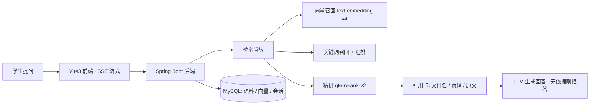

# 有章 · 校园规章问答助手

[](https://github.com/Lumjiel/knowledgeops-campus/actions/workflows/ci.yml)
[](LICENSE)
[](https://know.lumjiel.top)

> **在线体验**：<https://know.lumjiel.top> —— 打开即用，无需注册（后端自动签发 120 分钟游客凭证）。
> 语料：南京工程学院《学生手册》2023 版（含页码与条款结构）+ 高温作业安全规定示例文档。

**一句话**：学生问「旷课 50 学时会被怎么处分」，系统从《学生手册》PDF 里检索出原文条款，回答**强制附带页码级引用**——每一句话都能翻到手册第几页去核对。

## 它解决什么问题

校园规章类文档（学生手册、培养方案、安全规定）动辄几百页，关键词搜索靠蒙。有章把这类文档变成可问答、可核查的知识库：

| 能力 | 说明 |
|---|---|
| 条款级引用 | 每条回答附带「文件名 + PDF 页码 + 原文片段」引用卡，前端可展开核对原文 |
| 无依据拒答 | 手册里没有的内容明确说明「未找到直接依据」，绝不编造条款 |
| 检索可量化 | 独立检索端点 `/ai/retrieval/search` + 28 条标注回归集，Hit@K / MRR 每次改动都有数字 |
| 免注册体验 | 游客模式 `/auth/guest` 签发短时效低权限 JWT，按 IP 限流 |
| 轻量部署 | app + mysql + web 三容器，2 核 4G 云服务器即可跑满 |

三条能立刻验证的链路：

| # | 提问 | 预期表现 |
|---|---|---|
| 1 | 旷课 50 学时会被怎么处分 | 引用手册处分条款，带页码与原文展开 |
| 2 | 被记过了还能入党吗 | 命中推优细则（p126-127），给出结构化建议 |
| 3 | 今天南京适合跑 3000 米吗 | 手册无依据 → 明确说明「未找到直接依据」，不编造 |

## 架构一览



## 快速开始（lite 部署，推荐）

适用于 2 核 4G 云服务器（Docker + Docker Compose 已装），完整步骤见 [docs/deploy-云服务器手册.md](docs/deploy-云服务器手册.md)：

```bash
git clone https://github.com/Lumjiel/knowledgeops-campus.git && cd knowledgeops-campus

# 1. 配置环境变量（模型密钥走 OpenAI 兼容接口）
cat > .env <<'EOF'
OPENAI_API_KEY=sk-xxxx
OPENAI_BASE_URL=https://dashscope.aliyuncs.com/compatible-mode/v1
OPENAI_CHAT_MODEL=deepseek-chat
MYSQL_PASSWORD=改一个强密码
APP_CORS_ALLOWED_ORIGINS=http://<服务器IP>
EOF
chmod 600 .env

# 2. 一键启动（app + mysql + web 三容器，向量库 simple、内存预算受控）
docker compose -f docker-compose.lite.yml up -d

# 3. 打开 http://<服务器IP> 验证三条链路
```

换语料：替换 `demo-data/` 下的 PDF，删除向量卷重启即自动重新导入（见部署手册「换语料」节）。

## 更多文档

[快速上手](docs/getting-started.md) · [本地运行](docs/local-run-guide.md) · [架构说明](docs/architecture-hybrid-retrieval.md) · [演示脚本](docs/demo-script.md) · [变更记录](CHANGELOG.md)

## 仓库结构

```
├── src/main/java/com/enterprise/iqk/   # Spring Boot 3 后端（Java 17）
│   ├── controller/                     #   REST 端点（chat / retrieval / auth / pdf）
│   ├── retrieval/                      #   检索管线：多路召回 + 两段重排
│   ├── rag/                            #   RAG 问答服务
│   └── ...
├── frontend/                           # Vue3 + Element Plus + Vite
├── demo-data/                          # 示例语料（学生手册 2023 版 PDF）
├── eval/                               # 检索评测：28 条标注集 + Hit@K / MRR 脚本
├── docs/                               # 架构文档与使用指南
└── docker-compose.lite.yml             # 轻量部署（推荐）
```

## 许可

MIT License，见 [LICENSE](LICENSE)。
