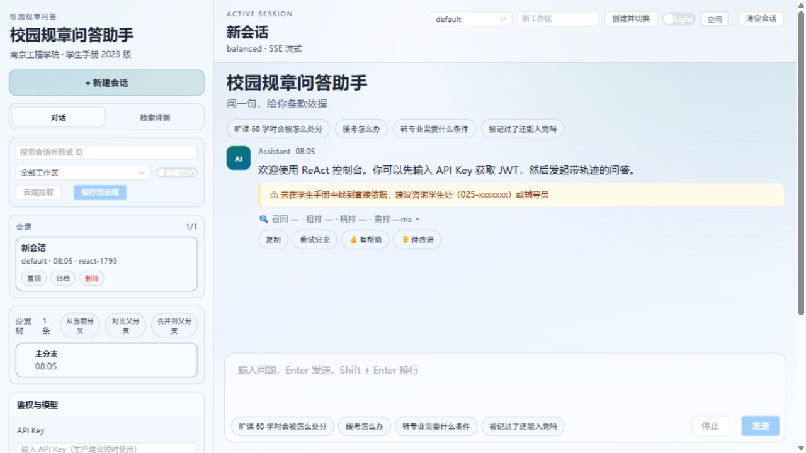
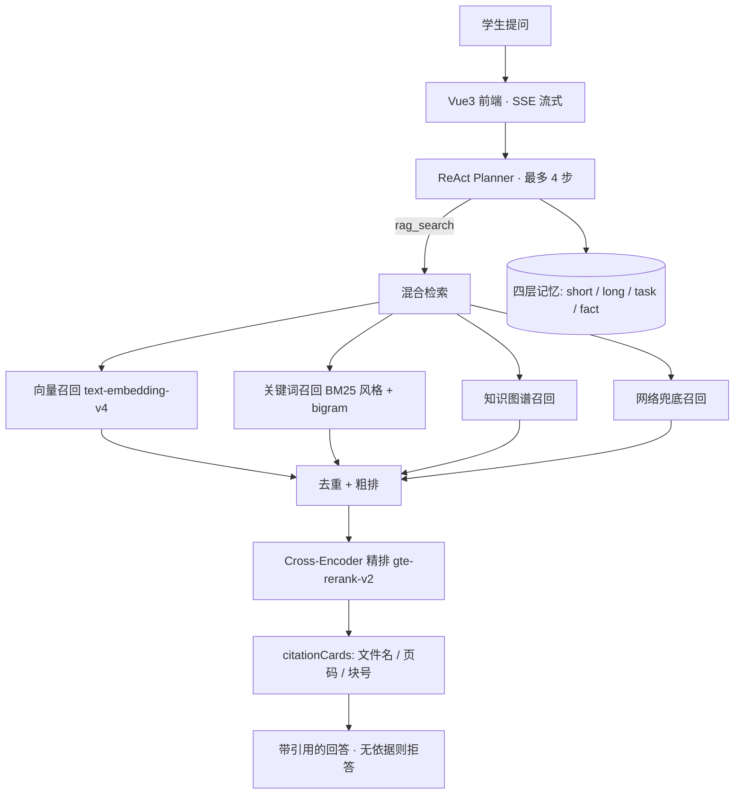
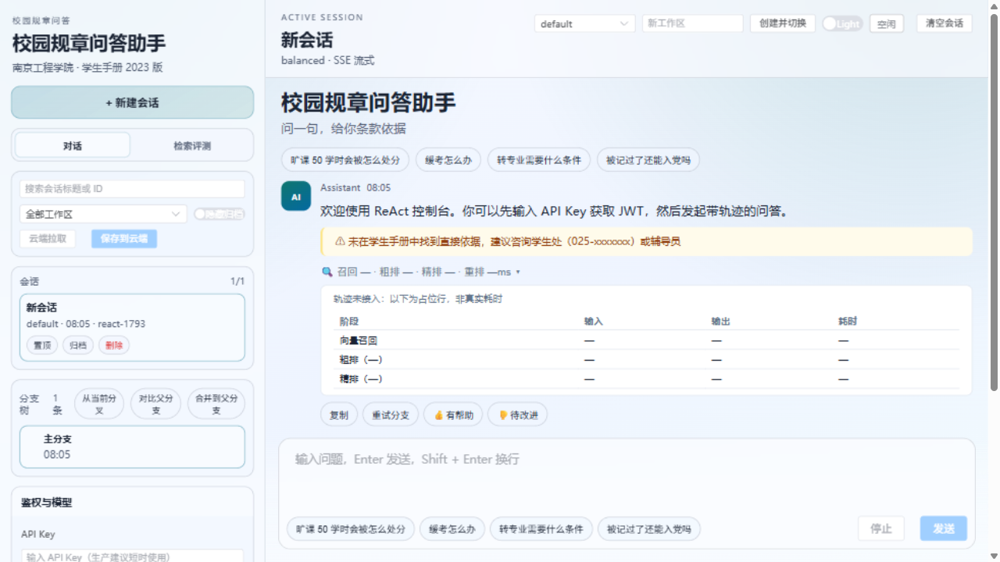

# 有章 · 校园规章问答助手

[](https://github.com/Lumjiel/knowledgeops-campus/actions/workflows/ci.yml)
[](LICENSE)
[](https://know.lumjiel.top)

> **在线体验**：<https://know.lumjiel.top> —— 打开即用，无需注册（后端自动签发 120 分钟低权限游客凭证）。
> 语料：南京工程学院《学生手册》2023 版（含页码与条款结构）+ 高温作业安全规定示例文档。

**一句话**：学生问「旷课 50 学时会被怎么处分」，系统从《学生手册》PDF 里检索出原文条款，回答**强制附带页码级引用**——每一句话都能翻到手册第几页去核对。

## 为什么它不是又一个套壳 RAG

| 校园场景的真实痛点 | 对应的做法 | 仓库里的证据 |
|---|---|---|
| 手册几百页，搜索只能靠关键词蒙 | 多路召回（向量 / BM25 风格关键词 / 知识图谱 / 网络兜底）+ 粗排、精排两段管线，800ms 延迟预算超时降级 | `HybridRetrievalService`、`RerankPipeline`、`RerankProperties` |
| 答得也许对，但学生不敢信 | 条款级引用卡：文件名 + PDF 页码 + 块序号，前端可展开原文；无检索依据时明确拒答，不编造 | `CitationService`、`citationCards`、`PdfController` |
| 检索变差不知道是检索层的锅还是生成层的锅 | 独立检索端点 `/ai/retrieval/search`：只跑召回 + 重排，不进 LLM | `RetrievalDebugController` |
| 检索改动全靠手感 | 28 条标注回归集 + Hit@K / MRR 脚本，每次改动都有数字 | [`eval/`](eval/README.md) |
| 学生不想注册就能问一句 | 游客模式：`/auth/guest` 免凭证签发短时效低权限 JWT，按 IP 限流 | `AuthController`、`SecurityConfiguration` |
| 多轮追问丢失上下文 | 对话式 ReAct：planner 自主决定检索词并支持换词重试（最多 4 步防死循环），记忆分 short / long / task / fact 四层落库 | `WorkflowReactAgentService`、`MemoryService` |

## 在线演示

入口：<https://know.lumjiel.top>（部署在南京云服务器，Nginx + Docker Compose）

三条能立刻验证的链路：

| # | 提问 | 预期表现 |
|---|---|---|
| 1 | 旷课 50 学时会被怎么处分 | 引用《学生手册》处分条款，带页码与原文展开 |
| 2 | 被记过了还能入党吗 | 命中推优细则（p125-127），给出结构化建议 |
| 3 | 今天南京适合跑 3000 米吗 | 手册无依据 → 明确说明「未找到直接依据」，不编造 |



## 一次提问的生命周期



> 说明：生产问答链路当前是「向量召回 → Cross-Encoder 精排」，四路召回完整形态跑在混合检索链路与评测链路上，合并进主链路列在路线图里——这条不一致在 `docs/PROJECT-CONTEXT.md` 里如实记录着。



## 检索层实测数据

标注集：`eval/annotations-handbook-v1.json`，28 条，从《学生手册》语料反向生成，支持跨 chunk 粒度的文本包含匹配。
评测方式：同一生产链路、只打独立检索端点、不进 LLM。

| 精排策略 | Hit@5 | MRR | e2e p50 | 结论 |
|---|---|---|---|---|
| RRF（排名融合） | 1.000 | 0.827 | 191ms | 基线 |
| gte-rerank-v2（Cross-Encoder） | 1.000 | **0.982** | 359ms | 生产采用，fine 中位 166ms，低于 800ms 预算 |

其他实验与校准（细节见 [`docs/rag-面试叙事.md`](docs/rag-面试叙事.md)、`docs/PROJECT-CONTEXT.md`）：

- **chunk 粒度对比**：400 提升排序精度但牺牲 Top-5 召回，最终保留 800。
- **相似度门控校准**：0.45 → 0.35。「被记过了还能入党吗」与正确 chunk 的余弦相似度实测 0.38~0.41，在 0.45 阈值下被误杀零召回；降到 0.35 后命中，噪音由 CE 精排兜住。
- **成本**：单次问答约 $0.004（对话模型走自建 OpenAI 兼容网关的 cheap 组，embedding 独立配置）。

## 技术栈

- Java 17、Spring Boot 3.4.5、Spring AI 1.1.7 稳定线（由 1.0.0-M6 迁移而来，迁移记录见 [docs/spring-ai-upgrade.md](docs/spring-ai-upgrade.md)）
- Spring Security 6（JWT + API Key + RBAC + 游客凭证）、Resilience4j、Bucket4j
- MyBatis-Plus、MySQL 8、Redis 7、RabbitMQ 3、SimpleVectorStore（可切 pgvector）
- Vue 3 + TypeScript + Element Plus + Vite，Nginx 托管
- Micrometer / OpenTelemetry / Prometheus / Grafana / Loki / Tempo
- Docker Compose（app / web / mysql / redis / rabbitmq / tempo）、Flyway 迁移

## 目录结构

```
src/main/java/com/enterprise/iqk/
├── agent/          # ReAct 智能体、工作流引擎、DeepResearch
├── rag/            # 混合检索、重排管线、证据评分、引用服务
├── ingestion/      # PDF 异步入库（队列 + 重试 + 幂等）
├── security/       # JWT / API Key / 游客凭证 / 限流 / 审计
├── memory/         # 四层记忆持久化
└── config/         # 安全、CORS、模型路由、可观测配置
frontend/           # Vue3 控制台（单文件主入口 + 设计令牌样式层）
eval/               # 检索层离线评测：28 条标注集 + Hit@K/MRR 脚本
evaluation/         # 后端评测模块（数据集 / 运行 / 综合分）
docs/               # 架构、部署手册、演示脚本、面试叙事
demo-data/          # 学生手册与示例语料
```

## 快速开始（本地）

```bash
git clone https://github.com/Lumjiel/knowledgeops-campus.git
cd knowledgeops-campus

# 一键起容器栈（app + mysql + redis + rabbitmq + web）
./scripts/demo.sh
```

启动后：

| 入口 | 地址 |
|---|---|
| 前端控制台 | <http://localhost:8088> |
| 后端 API | <http://localhost:8080> |
| Swagger UI | <http://localhost:8080/swagger-ui/index.html> |
| 健康检查 | <http://localhost:8080/actuator/health> |
| RabbitMQ 控制台 | <http://localhost:15672> |

本地源码方式开发：

```bash
mvn -DskipTests compile && mvn spring-boot:run     # 后端 :8080
cd frontend && npm install && npm run dev          # 前端 :5173
```

环境变量见 [.env.example](.env.example)；语料与入库说明见 [demo-data/README.md](demo-data/README.md)。

## 部署（南京服务器）

线上拓扑（Docker Compose 项目名 `knowledgeops`）：

| 容器 | 作用 | 端口 |
|---|---|---|
| `knowledgeops-agent` | Spring Boot 3 后端（prod profile） | 0.0.0.0:8080 |
| `knowledgeops-agent-web` | 前端（Nginx 托管构建产物） | 0.0.0.0:8088 |
| `knowledgeops-agent-mysql` | MySQL 8（命名卷持久化） | 内部 3306 |
| `knowledgeops-agent-redis` | 缓存 | 内部 |
| `knowledgeops-agent-rabbitmq` | 消息队列 | 内部 |

入口链路：`https://know.lumjiel.top` → 宿主机 Nginx → `127.0.0.1:8088`（web 容器）→ 反代 `/api` 到 app 容器。

日常更新（前端 1-2 分钟）：

```bash
rsync -az --delete --exclude node_modules --exclude dist frontend/ nj-1:/opt/knowledgeops/frontend/
ssh nj-1 'cd /opt/knowledgeops && docker compose build web && docker compose up -d web'
```

完整流程、六个实战坑（Flyway 幂等、CORS 白名单、`.env` 变量丢失、ReAct conversationId 等）见
[docs/deploy-云服务器手册.md](docs/deploy-云服务器手册.md)。

## API 概览

| 能力 | 端点 |
|---|---|
| 会话问答 | `GET/POST /ai/chat`、`POST /ai/react/chat/stream`（SSE: `trace` / `token` / `done`） |
| 检索（独立端点，不进 LLM） | `POST /ai/retrieval/search` |
| 混合检索与图谱 | `POST /ai/rag/search`、`GET /ai/graph/search` |
| 知识入库 | `POST /ai/pdf/upload/{chatId}`、`GET /ingestion/jobs/{jobId}`（支持 `X-Idempotency-Key` 去重） |
| 引用原文 | `GET /ai/pdf/file/{chatId}?source=...`（会话 + 全局语料两层作用域） |
| 深度研究 | `POST /ai/research/tasks`、`GET /ai/research/tasks/{taskId}/report` |
| 鉴权 | `POST /auth/token`、`POST /auth/refresh`、`POST /auth/guest`（游客） |
| 审计与历史 | `GET /audit/logs`、`GET /ai/history/{type}/{chatId}` |

请求示例见 [docs/api-recipes.md](docs/api-recipes.md)。

## 评测与工程质量

```bash
# 后端：单元 + 切片测试（121 个用例，其中 2 个需外部模型/PDF 的探索性用例默认跳过）
mvn clean test

# 检索层离线评测（Hit@K / MRR，需服务已启动）
python3 eval/run_retrieval_eval.py --annotations eval/annotations-handbook-v1.json --topk 6

# 前端
cd frontend && npm run ci    # eslint + prettier + vue-tsc
```

- **CI**：GitHub Actions 流水线覆盖静态分析（Checkstyle / PMD / SpotBugs）、编译测试与 JaCoCo 门禁、前端 lint 与构建、OWASP 依赖扫描、镜像构建、e2e 冒烟。
- **安全**：API Key / JWT 双鉴权、租户隔离、RBAC、限流、审计脱敏、安全响应头、CORS 白名单。
- **可观测**：`/actuator/health`、`/actuator/prometheus`、Grafana 仪表盘、告警规则（P95 延迟、入库失败率、连接池耗尽等）。

## 文档索引

- 项目上下文快照（当前状态 / 已知问题）：[docs/PROJECT-CONTEXT.md](docs/PROJECT-CONTEXT.md)
- 部署实录与运维速查：[docs/deploy-云服务器手册.md](docs/deploy-云服务器手册.md)
- RAG 面试叙事（架构讲述 / 追问 Q&A / 数据来源）：[docs/rag-面试叙事.md](docs/rag-面试叙事.md)
- 演示路径：[docs/demo-paths.md](docs/demo-paths.md)、演示脚本 [docs/demo-script.md](docs/demo-script.md)
- 快速上手：[docs/getting-started.md](docs/getting-started.md)、本地运行 [docs/local-run-guide.md](docs/local-run-guide.md)
- 架构说明：[docs/architecture-enterprise.md](docs/architecture-enterprise.md)、[docs/architecture-agent-harness.md](docs/architecture-agent-harness.md)、[docs/architecture-hybrid-retrieval.md](docs/architecture-hybrid-retrieval.md)
- 运维手册：[docs/operations.md](docs/operations.md)、可观测 [docs/observability.md](docs/observability.md)
- 变更记录：[CHANGELOG.md](CHANGELOG.md)

## 路线图

- [x] 条款级引用（citationCards）+ 引用原文展开
- [x] 独立检索端点 + 28 条标注集 + Hit@K / MRR 评测闭环
- [x] Cross-Encoder 精排接入与 A/B（MRR 0.827 → 0.982）
- [x] 相似度门控阈值校准（0.45 → 0.35）
- [x] 游客模式（免注册体验，按 IP 限流）
- [x] 全局语料作用域（shared-corpus，跨会话共享手册）
- [x] 四层记忆接线进问答链路
- [x] 移动端适配 + 流式渲染性能修复（long task 归零）
- [ ] 四路召回合并进生产问答主链路
- [ ] 重排策略可插拔（LLM-as-reranker）
- [ ] Tempo 容器版本兼容修复（当前已停用）
- [ ] 语料扩容：教务 / 学籍 / 考场规则等多份规章
- [ ] 分布式限流后端（当前为单实例内存桶）

## 许可

MIT License，见 [LICENSE](LICENSE)。