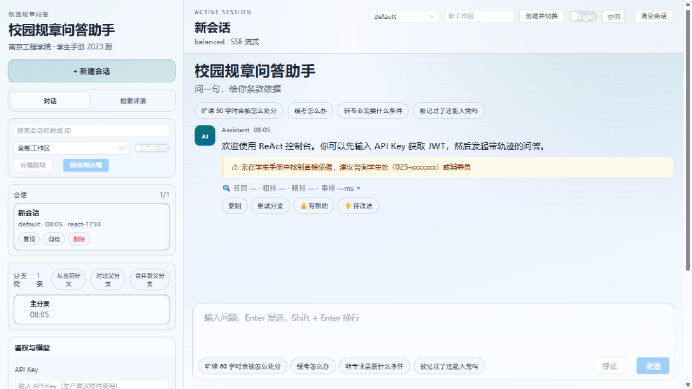
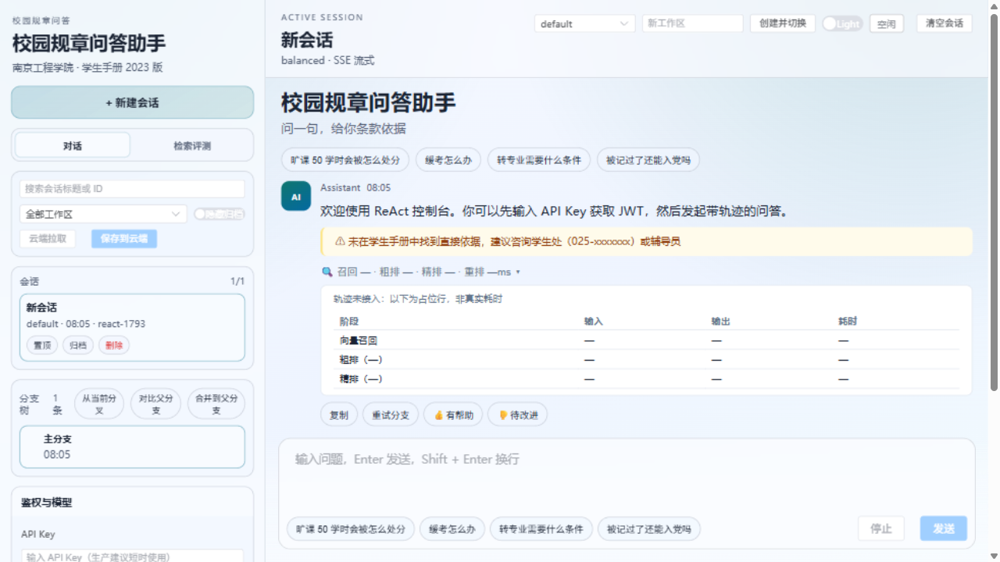

# 有章 · 文档中心

有章是一个面向高校规章场景的 RAG + ReAct 问答助手：把几百页的学生手册变成可检索、可引用、可核对的问答接口。
所有回答强制带页码级引用，检索质量有独立的离线评测脚本兜底。

## 从这里开始

| 你想做什么 | 去看 | 你会得到 |
|---|---|---|
| 五分钟跑起来 | [快速上手](getting-started.md) | Docker Compose 启动、健康检查、换取凭证、收尾清理 |
| 走一遍演示 | [可复现演示脚本](demo-script.md) | 语料上传、异步入库、带引用的问答、权限校验 |
| 调 API | [API 示例](api-recipes.md) | 可直接粘贴的 curl：问答、检索、入库、ReAct 流式、可观测 |
| 看懂系统 | [架构说明](architecture-enterprise.md)、[混合检索](architecture-hybrid-retrieval.md)、[Agent Harness](architecture-agent-harness.md) | 服务边界、检索与重排管线、Agent 工具执行、数据流 |
| 部署上线 | [云服务器部署手册](deploy-云服务器手册.md)、[企业部署指南](deployment-enterprise.md) | 南京服务器实际拓扑、更新流程、踩过的坑 |
| 运维 | [运维手册](operations.md)、[可观测](observability.md) | 指标、日志、链路追踪、告警、演练 |
| 搞清当前状态 | [项目上下文快照](PROJECT-CONTEXT.md) | 当前部署状态、变更日志、已知问题与待办 |
| 面试 / 技术讲述 | [RAG 面试叙事](rag-面试叙事.md)、[技术要点](talking-points/technical-pitch-notes.md) | 三档介绍、概念精讲、追问 Q&A、数据来源 |

## 视觉记录

| 界面 | 预览 |
|---|---|
| 空会话与引导 |  |
| 检索轨迹与证据面板 |  |

## 运行入口

本地栈起来之后可用：

| 入口 | 地址 |
|---|---|
| 前端控制台 | `http://localhost:8088` |
| 后端 API | `http://localhost:8080` |
| Swagger UI | `http://localhost:8080/swagger-ui/index.html` |
| OpenAPI JSON | `http://localhost:8080/v3/api-docs` |
| 健康检查 | `http://localhost:8080/actuator/health` |
| Prometheus 指标 | `http://localhost:8080/actuator/prometheus` |
| RabbitMQ 控制台 | `http://localhost:15672` |

线上环境：<https://know.lumjiel.top>

## 能力覆盖

| 领域 | 覆盖情况 |
|---|---|
| 问答与智能体 | ReAct 流式问答、DeepResearch、工作流状态机与事件溯源、工具调用、多轮会话 |
| 检索 | 多路召回（向量 / 关键词 / 图谱 / 网络）、粗排 + Cross-Encoder 精排、引用溯源、独立检索端点 |
| 入库 | PDF 上传、队列异步处理、失败重试与 DLQ、幂等去重、任务状态追踪 |
| 记忆 | short / long / task / fact 四层持久化 |
| 安全 | API Key / JWT / 游客凭证、RBAC、租户隔离、限流、审计脱敏、CORS 白名单 |
| 质量 | 28 条标注回归集、Hit@K / MRR 脚本、CI 静态分析、JaCoCo 门禁、e2e 冒烟 |
| 运维 | Docker Compose、Flyway 迁移、Prometheus / Loki / Tempo / Grafana、告警规则 |

## 文档地图

| 分类 | 文档 |
|---|---|
| 总览 | [项目 README](../README.md)、[路线图](roadmap.md) |
| 本地运行 | [快速上手](getting-started.md)、[本地运行指南](local-run-guide.md)、[演示脚本](demo-script.md)、[API 示例](api-recipes.md) |
| 架构 | [企业架构](architecture-enterprise.md)、[混合检索](architecture-hybrid-retrieval.md)、[Agent 工作流](architecture-agent-workflow.md)、[Agent Harness](architecture-agent-harness.md)、[知识图谱](architecture-knowledge-graph.md)、[记忆系统](architecture-memory-system.md)、[MCP 桥](architecture-mcp-bridge.md) |
| 评测 | [检索层评测](../eval/README.md)、[后端评测模块](../evaluation/README.md) |
| 部署与运维 | [云服务器部署手册](deploy-云服务器手册.md)、[企业部署指南](deployment-enterprise.md)、[运维手册](operations.md)、[可观测](observability.md)、[分布式演练](drills/distributed-and-observability-drill.md) |
| 讲故事 | [RAG 面试叙事](rag-面试叙事.md)、[技术要点](talking-points/technical-pitch-notes.md)、[证据清单](talking-points/evidence-checklist.md) |
| 施工记录 | [改造规格 A/B/C/D](specs/) |